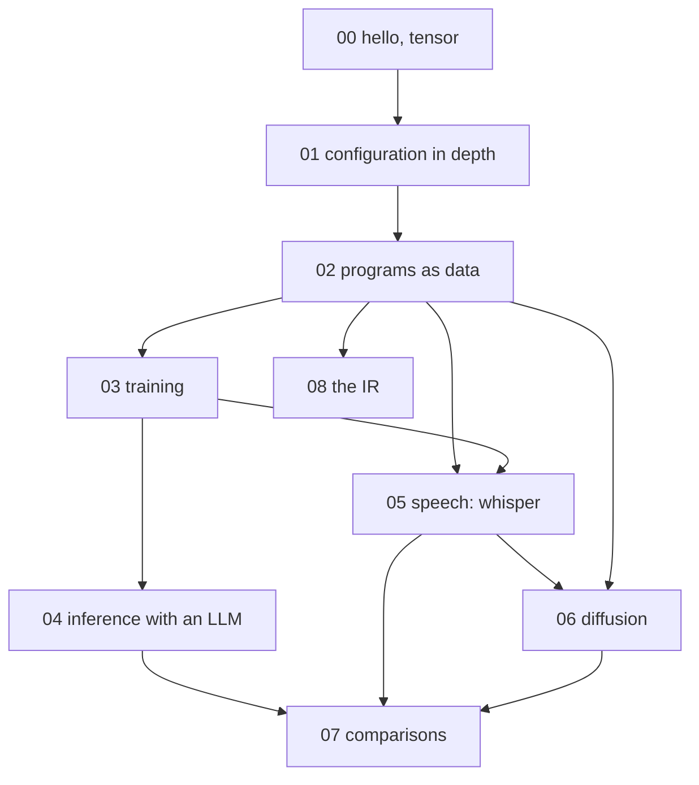

# omega tutorials

Omega runs tensor programs on a CPU or a GPU. These pages take you from one vector addition to a measured LLM decode, in the order you actually learn it: run something, change where it runs, describe a bigger program, train it, run inference, then compare against the tools you already use.

If you have ten minutes, read [00](./00-hello-tensor.md). If you want the numbers, jump to [07](./07-comparisons.md). Every page is runnable; how they were produced is at the end.

## The path

- [00: hello, tensor](./00-hello-tensor.md) — the whole first result in two commands: a program written in TOML, a daemon, and `sum [4] [10.0, 11.0, 12.0, 13.0]`. Then the same three ops in Rust, printing which device ran them, and the one-line config change from CPU to Metal. Start here even if you only came for inference; everything after assumes that a program is data.
- [01: configuration in depth](./01-config.md) — the four settings you will touch in your first week, then the other twenty-four. You will layer defaults, a file, the environment and explicit setters and see which wins per field, and read three validation failures that name the offending field. Ends with the three nested config types and the two standalone ones: the CUDA kernel cache and the CPU execution policy.
- [02: programs as data](./02-programs-as-data.md) — how a program file is actually structured: nodes and ids, static and symbolic shapes, the map grammar that says which element feeds which, the two leaf kinds that need no input data, and a bind list for when you do have data (`[[bind]]`, which names the tensors you will pass in). You run a bound plan, see both of its failure messages, and run a real spec from `proxima-tensor/specs/`: a rotary position embedding (RoPE).
- [03: training](./03-train.md) — the four lines of a PyTorch loop and the four calls that replace them. An optimizer loaded from `adam.toml`, one training step and then ten on Metal checked against the CPU, and four epochs on real MNIST: loss 0.4619 → 0.1352, 918 of 1000 test images correct.
- [04: inference with an LLM](./04-infer-an-llm.md) — loading a real GGUF, the three architecture facts a checkpoint does not carry, the serving config that mirrors llama.cpp's flags, and a decode on Llama-3.2-1B-Instruct f16 at 20.9 ms per token warm.
- [05: speech, whisper](./05-speech-whisper.md) — which pieces of a whisper pipeline exist today (log-mel front end, cross-attention, conv1d, rope tables), each shown with the test that proves it, and the exact point where an audio file would fall off the end. That point is out of date: `Model::transcribe` (`proxima-model-interop/src/families/encoder_decoder_host.rs:1135`) now takes a waveform to a transcript, and `transcript::ids_and_text_match_the_reference` (`proxima-model-interop/tests/whisper.rs:1350`) asserts the reference token ids, end-of-text and text for one fixture wav at 16 kHz, language `en`. The page itself is unchanged.
- [06: diffusion](./06-diffusion.md) — the same treatment for image generation: adaLN modulation, non-causal attention, norm without affine and layer taps exist and are differentiable, and the FLUX.2 klein image path (Euler scheduler, VAE decode, checkpoint reader) runs end to end on Metal; the page carries the 2026-11-24 measurements.
- [07: comparisons](./07-comparisons.md) — omega against burn, PyTorch, llama.cpp, whisper.cpp and stable-diffusion.cpp. Every row is a measured number with its command, hardware, run count and variation, or a named gap with the missing artifact. The first number is the one that hurts: whisper on Metal takes about 1.5x as long as whisper.cpp greedy for tiny and 47.2x for large-v3-turbo, which was not re-measured (section 5). LLM results depend on the model: flint decode is 0.904x of llama.cpp, granite is behind (section 2). FLUX.2 klein is 0.82x of sd.cpp on wall time and loses on DiT load, 6.3 s warm against 1.74-1.87 s (section 6).
- [08: the IR](./08-the-ir.md) — the IR from the lowest algebra up: the five `Op` variants and 17 `ScalarOp`s, how `Elementwise` and `Reduce` compose (a matmul is a `Reduce` over a product body), the eight fused `BoundOpKind` forms, what binding adds, and how a backend lowers it with `Dialect` plus `render::{load, store}`. Ends with the map of what is not yet that simple transform and a five-line checklist. Read before designing or changing any lowering.

## Dependency graph

## Relationship to the rest of the tree

This is the operations track: tensors, training, inference. The runtime track is [`docs/tutorials/`](../tutorials/README.md), which teaches the pipe algebra and serving on the same rules. If you want the compiler internals instead — how a plan becomes a kernel, how the Metal and CUDA emitters are built — read `proxima-tensor/specs/omega-compiler-teaching/SPEC.md`.

## Gaps

The gaps a reader hits first, plus the ones that affect more than one page. Every page ends with its own full list; each row here is a fact with the line that proves it.

| gap | proof |
|---|---|
| The daemon path has no runtime-TOML surface; config is `OMEGA_*` per request | `tools/proxima-cli/src/tensor_run.rs:59` |
| `proxima tensor run` does not report which device served a plan | `tools/proxima-cli/src/tensor.rs:105` |
| Build `proximad` without `--features metal` and `OMEGA_ENGINE=gpu` is refused with a message naming the feature | `tools/proxima-cli/Cargo.toml:28` |
| `numerics` is recorded and not read by lowering | `omega/src/config.rs:102` |
| Three of four optimizers have no file loader | `proxima-autograd/src/optimizer.rs:632`, `:755`, `:985` |
| A plan cannot include another plan | `proxima-tensor/src/spec/program_spec.rs:26-45` |
| The eleven production specs are not reachable from the CLI (they carry no `[[bind]]`) | `tools/proxima-cli/src/tensor.rs:41-45` |
| Whisper transcribes end to end through `Model::transcribe`, checked against reference ids and text on one fixture wav; that test covers no other clip or language | `proxima-model-interop/tests/whisper.rs:1216`, `proxima-model-interop/src/families/encoder_decoder_host.rs:687` |
| FLUX.2 klein runs end to end on Metal only: no CPU end-to-end run, CUDA blocked on a driver mismatch, no wgpu run; S4 onward is open in the spec | `proxima-model-interop/specs/flux2-klein/SPEC.md:3`, [06](./06-diffusion.md) |
| MLX and Core ML exist but cannot be selected by config | `omega/src/backend.rs:113`, `omega/src/config.rs:298` |
| `fit` takes every batch in memory; no streaming loader | `proxima-autograd/src/train.rs:171-178` |
| Training is a library call; `proximad` has no training route | `tools/proxima-cli/src/tensor_run.rs:94` |

## How these pages were produced

- Nothing is used before it is taught. The graph above is the order; a page may only use what an earlier page introduced.
- Every fact has a line. A type, a function or a default is cited `file:line`, and the line was opened before the sentence was written.
- Every command shows its output. The `text` block under a command is what that command printed here. Where nothing could be run, the page names the missing artifact instead of estimating.

`cargo val` also reports doctests in its `SUMMARY`; where a page shows two passes for a one-test filter, the second is a doctest, and the named test is the first line. Every command on every page was run on an Apple M1 Max, in `rustc`'s debug profile unless the line says `--release`. A debug wall clock is a debugging aid, never a performance claim; page 07 is the only page that makes performance claims, and each of its rows names the build profile and the load it was taken under.

Run one cargo job at a time, and check the test count: `cargo val` prints `SUMMARY passed=N failed=0`, and a run of zero tests is a failure.
