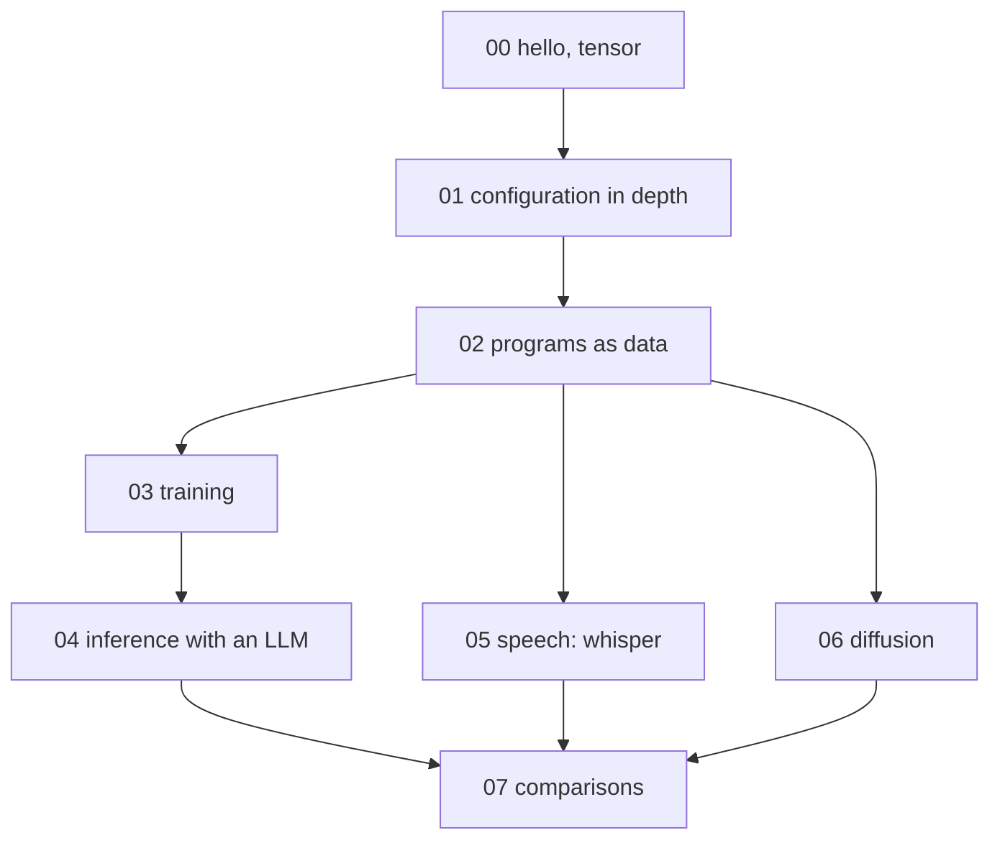

# omega tutorials

Teaching material for **humans** using omega: the part of proxima that plans and runs tensor programs on a CPU and on a GPU. It is the operations track. If you want the internals (how a plan lowers to a kernel, how the MSL/CUDA emitters are built), read `proxima-tensor/specs/omega-compiler-teaching/SPEC.md` instead.

The runtime-side curriculum is [`docs/tutorials/`](../tutorials/README.md). Same discipline, different subject: this tree teaches tensors, training and inference; that one teaches the pipe algebra and serving.

## The discipline

Every page obeys three rules, and you can check each one mechanically.

1. **No forward references.** A concept appears only after the page that teaches it. The dependency graph below is the contract.
2. **Every claim is a citation.** A type, a function or a default is cited `file:line`, and the line was opened before it was written down.
3. **Every shell block has real output.** The `text` block after a command is what that command printed on the machine named in the page, not a plausible-looking transcript. A row with no number is a named gap, never an estimate.

## Dependency graph



## Start here

- **[00: hello, tensor](./00-hello-tensor.md)** — what omega is · `Engine` and `GpuDriver` · `RuntimeConfig` as a two-line TOML file and as a builder · `ProgramSpec` as TOML (`iota`, `constant`, `elementwise`) · running a plan on `proximad` with no Rust · the same nodes embedded in Rust, printing the device that served them. Start here even if you only want inference: everything after assumes the plan-is-data idea.
- **[01: configuration in depth](./01-config.md)** — all 28 `RuntimeConfig` fields with their defaults · defaults → file → environment → setter, and which wins per field · validation errors that name the field (`engine`, `cpu_workers`, a typo'd key) · `SelectionConfig` · `ResourceConstraints` · `NumericPolicy::bit_exact` · `KernelCacheConfig` · `TensorExecutionConfig` as a plan's `[exec]` table.
- **[02: programs as data](./02-programs-as-data.md)** — the node envelope (`id`, `dtype`, `name`) · `ExtentSpec` static and symbolic · `MapSpec` projection and gather · the five node kinds · `[[bind]]` versus an input's `name`, and the two unbound-input errors · `plan_parts` and `collect_outputs` · running the bound fixture through `omega/examples/run_plan.rs` · `proxima-tensor/specs/rope.toml` and its pair-norm test · why the eleven production specs are shape-addressed rather than bound.
- **[03: training](./03-train.md)** — the PyTorch loop mapped onto forward-as-program, loss-as-node, `differentiate`, and the Adam graph · `AdamConfig` from `adam.toml` with a field-naming validation error · one step and ten steps on Metal at CPU parity · four epochs on real MNIST (loss 0.4619 → 0.1352, test accuracy 918/1000) · `State` as named buffers.
- **[04: inference with an LLM](./04-infer-an-llm.md)** — checkpoint formats (GGUF, safetensors) · the architecture's three non-checkpoint facts in `src/arch/llama.toml` · `CheckpointSource::load_serving` · the four generation entry points · `ServingSettings` as the llama-flag config surface (`PROXIMA_SERVING_*`) and the `omega_runtime` hook · a measured decode on Llama-3.2-1B-Instruct f16.
- **[05: speech, whisper](./05-speech-whisper.md)** — what exists today: an STFT log-mel front end, cross-attention with a once-per-utterance KV, conv1d, multi-axis rope tables, each a generic lowering with a finite-difference gradient test · what does not exist: a whisper model path (`proxima-model-interop/specs/whisper/SPEC.md` is a draft, R2 forbids a per-model profile).
- **[06: diffusion](./06-diffusion.md)** — what exists today: adaLN `modulate`, non-causal attention, layer norm without affine, tap-stacking, each tested on a non-model shape and differentiated against finite differences · what does not exist: an image path (`proxima-model-interop/specs/flux2-klein/SPEC.md` is a draft; no scheduler driver, no VAE decode).
- **[07: comparisons](./07-comparisons.md)** — omega versus burn, PyTorch, llama.cpp, whisper.cpp and stable-diffusion.cpp: every row either a measured number with its exact command, hardware, N and CoV, or a named gap with the missing artifact.

## What this tree found, and what it changed

Three defects were found while writing the pages, and all three are fixed in the same commits that add the pages:

- `omega/README.md` and `omega/src/lib.rs:1-3` described omega as an MSL emitter only, while `omega/src/backend.rs:113` plans and executes on a CPU and a GPU. Both now describe the crate as it is.
- `proxima tensor run` printed `<name> <shape> <n> floats` with no values, which made a hello page impossible; it now prints the values (`tools/proxima-cli/src/summary.rs:17`), eliding past eight.
- no optimizer config could load from a file; `AdamConfig::from_file` (`proxima-autograd/src/optimizer.rs:293`) is the pattern, tested against `proxima-autograd/examples/adam.toml`.

## Gaps

Aggregated from every page's closing section. Each is a fact with a line that proves it, not a wish list.

| gap | proof |
|---|---|
| The daemon path has no runtime-TOML surface; config is `OMEGA_*` per request | `tools/proxima-cli/src/tensor_run.rs:59` |
| `proxima tensor run` does not report which device served a plan | `tools/proxima-cli/src/tensor.rs:105` |
| Build `proximad` without `--features metal` and `OMEGA_ENGINE=gpu` is refused, not silently CPU | `tools/proxima-cli/Cargo.toml:28` |
| `numerics` is recorded and not read by lowering | `omega/src/config.rs:102` |
| Three of four optimizers have no file loader | `proxima-autograd/src/optimizer.rs:632`, `:755`, `:985` |
| A plan cannot include another plan | `proxima-tensor/src/spec/program_spec.rs:26-45` |
| The eleven production specs are not reachable from the CLI (they carry no `[[bind]]`) | `tools/proxima-cli/src/tensor.rs:41-45` |
| No whisper model path; the spec is a draft and R2 forbids a per-model profile | `proxima-model-interop/specs/whisper/SPEC.md:3`, `:22` |
| No diffusion model path; the spec is a draft, no scheduler driver or VAE decode | `proxima-model-interop/specs/flux2-klein/SPEC.md:3` |
| MLX and Core ML exist but cannot be selected by config | `omega/src/backend.rs:113`, `omega/src/config.rs:298` |
| `fit` takes every batch in memory; no streaming loader | `proxima-autograd/src/train.rs:171-178` |
| Training is a library call; `proximad` has no training route | `tools/proxima-cli/src/tensor_run.rs:94` |

## Running the pages

One cargo job at a time, `-j 2`, and a nonzero test count when you run tests:

```sh
CARGO_TARGET_DIR=/tmp/cargo_target_omega63 cargo val -p proxima-tensor -E 'test(rope)'
```

The pages were run on an Apple M1 Max with `rustc`'s debug profile unless a line says `--release`. A wall clock in a debug run is a debugging aid, never a performance claim; page 07 is the only page that makes performance claims, and every one of its rows names its build profile.
